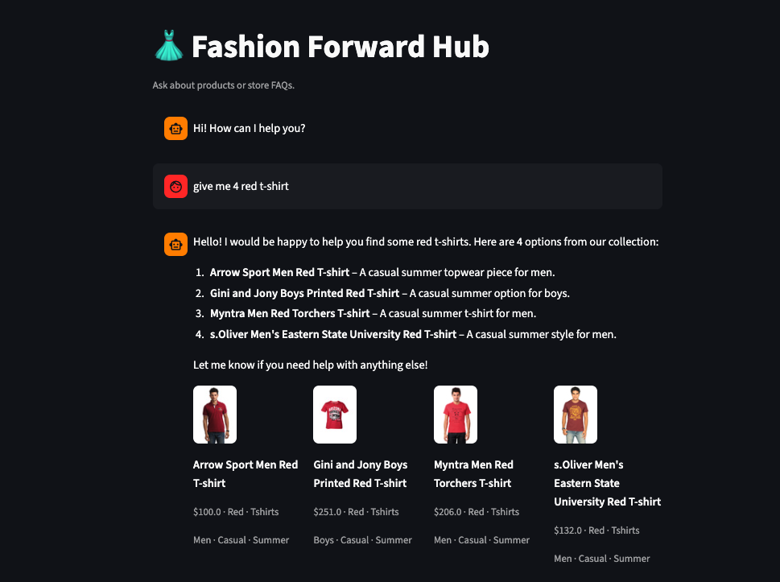
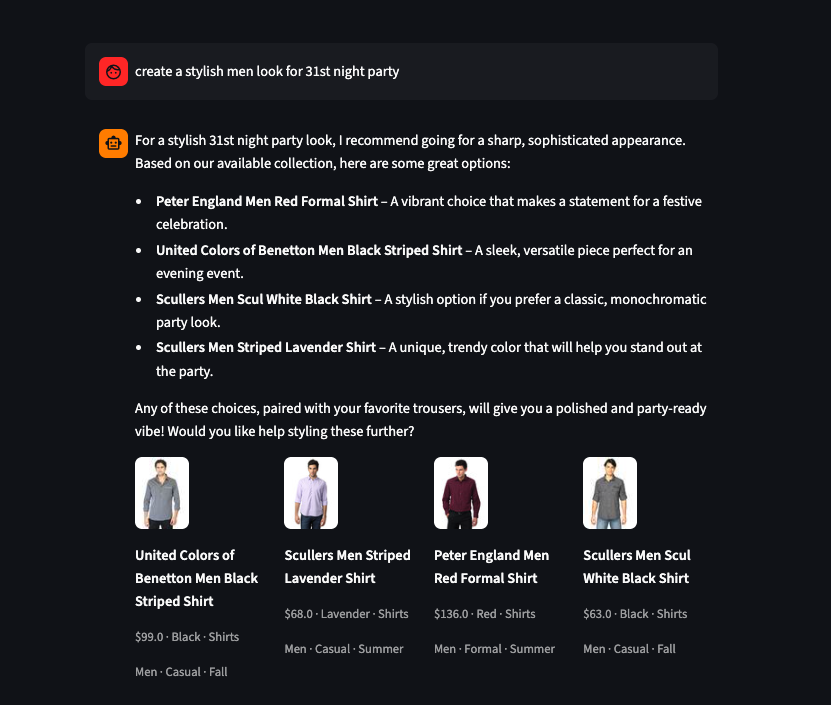
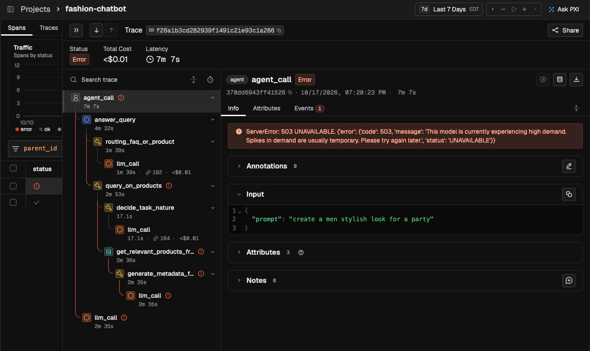
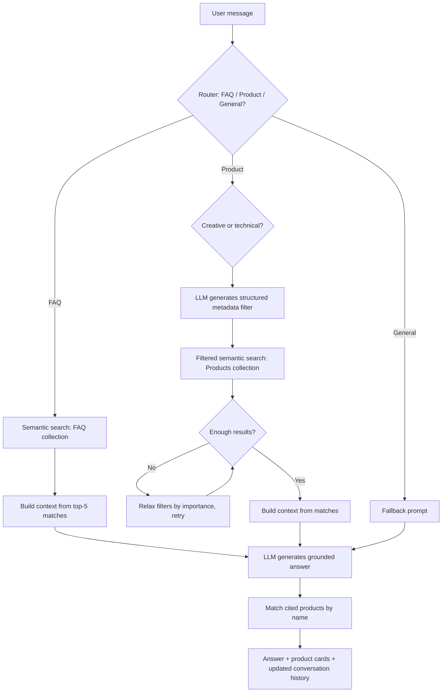

# Fashion Forward Hub — RAG Chatbot

A retrieval-augmented chatbot for an e-commerce clothing store that handles two kinds of questions:

- **Customer support (FAQ):** "What's your return policy?", "How long does shipping take?", "Can I change my order after it's placed?"
- **Product discovery:** "Do you have blue t-shirts under $50?", "Suggest an outfit for a wedding."

Every answer is grounded in a real product catalog and FAQ knowledge base rather than the LLM's own guesses.

Each incoming query is routed to the appropriate retrieval strategy, the relevant facts are pulled from a vector database, and only then does the LLM compose a response, grounded in the specific products or FAQ entries it used, which are then rendered as real product cards (photo, price, color, category).


## Demo





Tracer:



## Features

- **Query routing** — classifies each message as FAQ, Product, or general chit-chat before deciding how to answer it
- **Semantic search** over both the FAQ knowledge base and the product catalog, using Gemini embeddings
- **LLM-generated structured filters** — for product queries, the LLM extracts a structured filter (gender, category, color, price range, usage, season) from natural language and applies it to the vector search.
- **Creative vs. technical intent detection** — adjusts LLM sampling parameters (temperature/top-p) depending on whether the query calls for a creative styling suggestion or a factual product lookup
- **Product cards** — cited products are matched by name and rendered as cards with photo (if available), price, color, category, gender, usage, and season
- **Observability** — every router decision, retrieval, and LLM call is traced with [Arize Phoenix](https://phoenix.arize.com/) / OpenTelemetry (OpenInference spans), so a single chat turn's full decision path — routing, retrieved documents, filters applied, token counts — is inspectable in a trace UI

## Architecture



## Tech Stack

| Layer | Choice | Why |
|---|---|---|
| LLM | [Gemini API](https://ai.google.dev/) | Routing, filter generation, and final answer generation |
| Embeddings | Gemini embeddings API | Same provider as the LLM |
| Vector DB | [Weaviate](https://weaviate.io/) (embedded) | Metadata filtering + vector search, runs in-process with no separate server/Docker setup |
| UI | [Streamlit](https://streamlit.io/) | Fast to build a real chat interface |
| Observability | [Arize Phoenix](https://phoenix.arize.com/) + OpenTelemetry | Traces every router/retrieval/LLM step as nested spans|
| Testing | pytest | Unit tests for routing/pipeline logic; a live accuracy eval against a labeled query set |

## Project Structure

```
.
├── app/
│   ├── config.py        # env vars, model names, paths
│   ├── data.py          # loads the product catalog and FAQ corpus
│   ├── embeddings.py     # Gemini embeddings wrapper (batching + retry/backoff)
│   ├── vectorstore.py     # Weaviate collection setup, insert, search, metadata filters
│   ├── llm.py              # Gemini generation wrapper (single-turn + multi-turn, retry/backoff)
│   ├── router.py            # FAQ-vs-Product and creative-vs-technical classifiers
│   ├── retrieval.py          # semantic search + LLM filter generation + progressive relaxation
│   ├── pipeline.py            # ties routing + retrieval into a final prompt
│   ├── chatbot.py              # conversation history, per-turn orchestration, product citation matching
│   └── tracing.py               # Phoenix/OpenTelemetry tracer setup
├── data/
│   ├── clothes_json.joblib       # product catalog
│   ├── faq.joblib                  # FAQ corpus
│   └── images/                      # optional "{product_id}.jpg" photos, gitignored (not committed)
├── scripts/
│   └── build_index.py          # one-time script to embed and index the dataset
├── tests/
│   ├── fixtures/
│   │   └── faq_or_products.csv   # labeled queries for the router-accuracy eval
│   ├── test_pipeline.py        # routing/pipeline wiring tests (no network needed)
│   └── test_router.py           # live router-accuracy eval against labeled examples
├── streamlit_app.py              # chat UI entry point
├── requirements.txt
└── .env.example
```

## Getting Started

### Prerequisites

- Python 3.11+
- A [Gemini API key](https://aistudio.google.com/apikey)

### Installation

```bash
git clone <your-repo-url>
cd chatbot_fashion_house
python3 -m venv .venv
source .venv/bin/activate
pip install -r requirements.txt
```

### Configuration

```bash
cp .env.example .env
```

Then fill in `GEMINI_API_KEY` in `.env`. See [Configuration](#configuration) below for all available options.

### Build the index

Embeds the product catalog and FAQ corpus and populates the local Weaviate store:

```bash
python scripts/build_index.py
```

### Run the app

```bash
streamlit run streamlit_app.py
```


### (Optional) View traces

Tracing is on by default and exports to `http://127.0.0.1:6006` — run a Phoenix instance to view them. 

```bash
python3 -m venv ~/.phoenix-venv
~/.phoenix-venv/bin/pip install arize-phoenix
~/.phoenix-venv/bin/python -m phoenix.server.main serve
```
Installed in its own separate venv so the main project's dependencies stay lean. 

Start Phoenix *before* chatting (export is async, so a turn run while Phoenix is down just gets dropped), then open [http://localhost:6006](http://localhost:6006) and look at the `fashion-chatbot` project — each turn appears as a trace tree (`agent_call` → `routing_faq_or_product`, `get_relevant_products_from_query`, `llm_call`, etc.) with inputs/outputs and token counts. If Phoenix isn't running at all, the app behaves exactly the same — exports just retry quietly in the background and are dropped. Set `PHOENIX_ENABLED=false` to skip tracing setup entirely.

## Configuration

All configuration is via environment variables (`.env`):

| Variable | Default | Description |
|---|---|---|
| `GEMINI_API_KEY` | — | **Required.** Your Gemini API key |
| `GEMINI_ROUTER_MODEL` | `gemini-3.1-flash-lite` | Model used for routing/classification/filter-generation calls |
| `GEMINI_ANSWER_MODEL` | `gemini-3.1-flash-lite` | Model used for the final answer |
| `GEMINI_EMBEDDING_MODEL` | `gemini-embedding-001` | Embedding model for the vector store |
| `WEAVIATE_DATA_PATH` | `./weaviate_data` | Where the embedded Weaviate instance persists data |
| `MAX_PRODUCTS` | `300` | Caps how much of the product catalog gets indexed |
| `PRODUCT_IMAGES_DIR` | `./data/images` | Folder of `{product_id}.jpg` files to show in product cards; missing files just show a placeholder |
| `PHOENIX_ENABLED` | `true` | Set to `false` to skip tracing setup entirely |
| `PHOENIX_PROJECT_NAME` | `fashion-chatbot` | Project name traces are grouped under in Phoenix |
| `PHOENIX_COLLECTOR_ENDPOINT` | `http://127.0.0.1:6006/v1/traces` | Where traces are exported to |

## Testing

```bash
pytest tests/
```

- `test_pipeline.py` tests routing and prompt-assembly logic with stubbed LLM/retrieval calls — no network access needed.
- `test_router.py` evaluates the FAQ-vs-Product classifier's accuracy against a set of labeled example queries. It calls the real Gemini API, so it's automatically skipped if `GEMINI_API_KEY` isn't set.

## License

MIT
